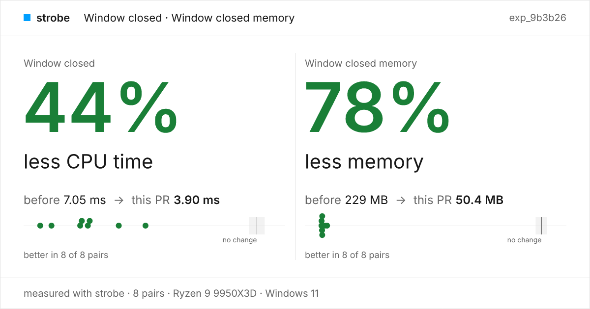

# strobe

Benchmarks for web pages, Electron apps and native apps, on Windows, macOS and Linux. It runs your before and after builds in alternating pairs, says whether the change really helped, and points at the code when it didn't. Numbers it can't defend get refused, with the reason, never printed.

```ts
// perf/scroll.bench.ts
import { bench, url } from "@hona/strobe"

export default bench({
  targets: { app: url("http://localhost:3000") },
  cases: {
    scroll: {
      primary: "main.work",
      run: ({ page }) => page.scroll("main", { by: 4000 }),
      reset: ({ page }) => page.scroll("main", { by: -4000 }),
    },
  },
})
```

```sh
bun add -d @hona/strobe && bunx strobe up                     # once per machine
strobe bench perf/scroll.bench.ts --base origin/main --head .  # did my branch help?
strobe report experiment exp_9b3b26 --format pr --update-pr 42 # put the result in the PR
```

<picture>
  <source media="(prefers-color-scheme: dark)" srcset="docs/card-dark.png">
  
</picture>

Other things it does:

```sh
strobe record app:desktop --for 10s                  # what is the installed app doing?
strobe query rec_3f9a hotspots                       # where did the time go?
strobe query rec_3f9a..rec_7c1d hotspots             # what got slower between two recordings?
strobe record app:desktop --probes memory --for 60s  # is it leaking?
strobe look app:desktop                              # what's on screen, as strobe sees it
strobe open rec_3f9a                                 # the whole recording in Perfetto
```

`app:desktop` is a profile in your repo's `strobe.json`: how to build and launch the app in a throwaway home, so benches never touch your real data. `strobe status` says what your machine can measure and which permission is missing.

Or just ask your agent: *"did this branch make scrolling faster?"*

**Agent quick start:** read [skill/SKILL.md](skill/SKILL.md). `strobe up` installs it as the `strobe` skill.

Design: [SPEC.md](SPEC.md)
