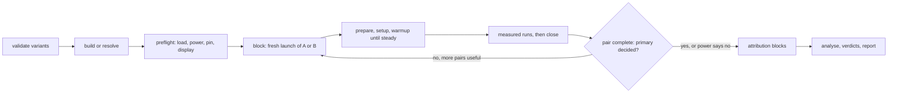
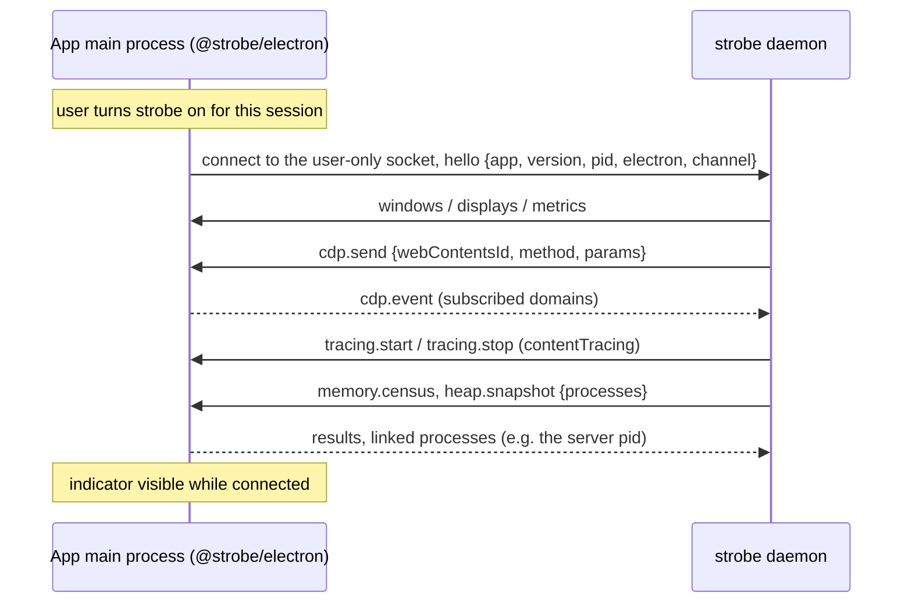

# strobe — spec

`strobe` measures and explains performance: a web page, an Electron app (including the installed
OpenCode desktop, Stable channel), a Bun or Node process, or any process by PID. It records
everything on one clock, refuses measurements it cannot defend, and gives people and agents a
verdict plus handles to drill into.

This file is the source of truth. If an implementation idea conflicts with it, stop and ask.
When a design change is agreed, update this file in the same change.

---

## 1. Rules (non-negotiable)

1. **Valid or nothing.** A number strobe cannot defend is not printed. Validators refuse a run
   (exit 4, §10.1); analysers warn next to the number (§10.2). Every number carries its unit,
   `n`, interval or `exact`, method, probe set, build and device.
2. **Measure the app, not strobe.** Low overhead first: no helper process where an OS API or a
   file read works; no polling where an event exists; budgets in §19 hold. strobe's own CPU, GPU
   and memory are a track in every recording.
3. **Timing and attribution never share a block.** Profilers, heap snapshots, allocation
   sampling, coverage, counters and instrumented builds change timing. They run in attribution
   blocks only (§8.1). A recording that mixes them is marked `mixed`, and its timing metrics
   are labelled `perturbed`.
4. **One primary metric per experiment**, declared before the run. Secondary metrics get a
   verdict only through the gate in §9.3; otherwise they are descriptive.
5. **No automated tests. Ever.** No unit, integration, e2e or snapshot tests, no test files, no
   test dependencies, no test steps in CI. Verification is the calibration page and A/A runs on
   real devices (§10.3, §10.4). CI only builds release binaries.
6. **Early iteration speed beats everything else.** Smallest change that works. No speculative
   abstraction.
7. **One concept, one name.** Each MCP tool is exactly a CLI command: same name, same
   arguments, same JSON as `--json`.
8. **Raw, general tools.** Five MCP tools (§17). New questions become views or arguments, not
   new tools.
9. **Local only.** Recordings never leave the machine unless the user copies them. Traces and
   heap snapshots can hold prompts, file contents and credentials: they are written owner-only,
   reports and MCP results carry aggregates, and string contents appear only with `--reveal`.
10. **Never break user space.** strobe writes only its own files and marked managed entries, all
    removed by `strobe leave`. It never changes a target's settings, profile or data. Launched
    targets get isolated homes; attached targets are left as they were on detach.
11. **One-time setup does every privileged step.** `strobe up` asks for the one UAC or sudo it
    needs. After that nothing prompts; `status` only reports problems.
12. **Rust stable, pragmatic dependencies.** Well-known crates are fine. Each dependency has a
    one-line reason in `Cargo.toml`. The budgets in §19 decide, not taste. No crate that needs a
    C compiler: every device builds with the plain Rust toolchain (adais has no C toolchain).
    One-time downloads shell out to `curl` (built into Windows 10+, macOS and Linux) instead of
    linking TLS.
13. **No backwards compatibility while pre-1.0.** Breaking changes are fine. No migration code.
14. **Normal speed only.** strobe never slows the target: no CPU throttling, no network
    throttling, no frame-rate caps in timing blocks. CPU throttling slows only the renderer's
    main thread, so the bottleneck moves where no real device has it. Small effects are found
    with more pairs, stress comes from bigger workloads (`params`), and slow hardware is measured
    on slow hardware (`--on`). The `Throttled` validator (§10.1) catches a slowed target from any
    cause.

## 2. Invariants

- Windows 10+, macOS 13+, or Linux (glibc or musl), x64 or arm64.
- `gh` installed and authenticated (install and update, like mesh).
- `opencode` installed for MCP and skill registration. Not needed to measure.
- Chromium targets: an installed Chrome, Edge or Chromium, or Playwright's Chromium. strobe finds
  one; it never downloads a browser.
- Deep mode (§13.4): one UAC (Windows) or one sudo (Linux) during `up`.

Tools may be installed but not on PATH (desktop-app shells). strobe looks in known install
locations, not only PATH.

## 3. Glossary

| Term | Meaning |
|---|---|
| target | What is measured (§5.1) |
| probe | One source of data: trace categories, CPU sampler, OS sampler, heap census, … (§8.1) |
| probe set | Named group of probes: `timing`, `attribution`, `memory`, `deep` |
| recording | Everything one capture produced, addressed by a handle `rec_…` |
| experiment | One `bench` invocation, addressed by `exp_…` |
| variant | One side of an experiment: a git ref, a directory, an installed app |
| bench file | A `.bench.ts` file: targets, params, setup and cases (§9.6) |
| case | One entry in a bench file's `cases`, with its `run` function |
| series | One case × target × params combination: the unit that gets a verdict |
| run | One call of a case's `run` (BenchmarkDotNet's iteration) |
| phase | A named span inside a run, such as `down` |
| block | One fresh launch of one variant: prepare, setup, warmup runs, measured runs, close |
| pair | Two adjacent blocks of different variants; order alternates A B, B A |
| timing / attribution block | A block with the `timing` probe set, or with profilers (§8.1) |
| primary | The metric the experiment is about, declared before the run |
| verdict | `faster`/`slower` (or `less`/`more`, `fewer`/`more`), `same`, `unclear`, `underpowered`, `refused` |
| validator | A check that refuses a run (§10.1) |
| analyser | A check that warns in the result (§10.2) |
| census | A consistent per-process memory account at one moment (§8.6) |
| bridge | `@strobe/electron` inside an app's main process (§13.2) |
| calibration | The known-cost page every probe must recover (§10.3) |
| A/A | An experiment with the same build on both sides (§10.4) |

## 4. Repo and files

### 4.1 Tool repo — `Hona/strobe` (private for now)

```
Cargo.toml  build.rs
src/            one package: lib + bins strobe, strobew (Windows windowless); §4.3
viewer/         Solid + canvas viewer, built into src/ui/dist and embedded
calibration/    the known-cost page (static), embedded
sdk/            TypeScript: @strobe/bench, @strobe/web, @strobe/electron, @strobe/playwright
                (one Bun workspace)
skill/SKILL.md  the built-in skill, embedded (include_str!)
schema/         strobe.v1.json (project config), result.v1.json, bridge.v1.json
install.sh  install.ps1
.github/workflows/release.yml   build + release only, no tests
SPEC.md  AGENTS.md  README.md
```

### 4.2 Local state (per device, never in a repo)

State dir: `~/.local/share/strobe/` (respect `XDG_DATA_HOME`) on Linux and macOS;
`%LOCALAPPDATA%\strobe\` on Windows. Created `0700` / user-only ACL.

```
state.json          { "mcp_port", "helper", "engine", "last_calibration" }
mcp-token           MCP bearer token, user-only
experiments/<exp>/  result.json per experiment; index.jsonl lists them (§14.2)
recordings/<rec>/   §14.1
builds/<key>/       variant build cache (§9.5)
symbols/            source maps by debug ID, PDB cache
engine/<version>/   trace_processor (§15), sha256-checked
run/  log/          temp files; daemon.log, helper.log (rotated at 1 MB)
daemon-<build>.sock Linux/macOS daemon socket (Windows: named pipe, §16)
```

Installed binary: `~/.local/bin/strobe` (Linux/macOS); `%LOCALAPPDATA%\Programs\strobe\{strobe,strobew}.exe`
(Windows, on user PATH). The deep-mode helper lives where only an elevated step can write
(§13.4).

### 4.3 Architecture (`src/`)

```
lib.rs          module declarations only
main.rs         bin `strobe`: parse args → app → exit code
bin/strobew.rs  Windows windowless build (daemon autostart)
cli/            argument parsing, help, text + JSON rendering
app/            commands (up, status, record, bench, query, report, top, update, leave, daemon)
model/          plain data: Target, Probe, Recording, Run, Metric, Verdict, Env, Validity
target/         finding and driving targets → chromium.rs (CDP), bridge.rs, inspector.rs,
                process.rs, launch.rs (isolated launches)
probe/          collecting → trace.rs, cpu.rs, heap.rs, census.rs, coverage.rs,
                os/{windows,linux,macos}.rs, gpu/{pdh,nvml,d3dkmt,drm,ioreport}.rs, helper.rs
engine/         trace_processor: the only place that runs it (§15)
store/          experiments/ and recordings/: the only place that writes them (§14)
runner/         the bench runner link: spawns `bun`, speaks the runner protocol (§9.6)
stats/          paired tests, intervals, modes, power, multiplicity (§9.3)
validity/       validators, analysers, calibration, A/A (§10)
symbol/         source maps, packages, owners, PDBs (§12)
report/         views → text, JSON, markdown, HTML (§11)
mcp/            MCP server: Streamable HTTP for the daemon, stdio (hidden)
host/           paths, processes, sockets, autostart, opencode registration, mesh
ui/             embedded viewer and calibration assets
```

- `cli`, `mcp` → `app` → everything else. Backends (`target`, `probe`, `engine`, `store`,
  `symbol`) depend only on `model` (and `host` for paths), never on `app`/`cli` or on each
  other's internals. They return `model` types.
- One backend each until a second exists. No traits or plugin layers ahead of need.
- Idiomatic Rust: `pub(crate)` by default, `cargo fmt`, `cargo clippy` clean.

## 5. CLI

```
strobe <command> [flags]

Setup      up · update · leave
Use        status · record · bench · query · report · top
Internal   daemon · mcp · helper (hidden)
Global     --json  -q/--quiet  -v/--verbose  -h/--help  -V/--version
```

### 5.1 Targets

| Syntax | Meaning |
|---|---|
| `https://…`, `http://…` | a page in a strobe-launched Chromium: isolated profile, real GPU, fixed window (§13.1) |
| `cdp:<port>`, `cdp:ws://…` | a running CDP endpoint (Playwright's, a dev Electron's) |
| `app:opencode`, `app:opencode-beta`, `app:opencode-dev` | OpenCode desktop: attached through the bridge or a debug port (§13.2, §13.3); `--launch` starts an isolated copy |
| `exe:<path>` | launch a packaged Electron app in an isolated home |
| `node:<port>`, `bun:<port>` | an inspector endpoint (§13.5) |
| `pid:<n>`, `proc:<name>` | outside-in only: OS, GPU, deep (§13.6) |
| `file:<path>` | import an existing capture: a Chrome trace, `.cpuprofile`, `.heapsnapshot`, or an OpenCode `opencode-heap-*` folder (§8.7) |
| `<target>@<device>` | run on a mesh device through `mesh exec`; results come back tagged with the device |

### 5.2 Exit codes

| Code | Meaning |
|---|---|
| 0 | success; for `bench`, a verdict was reached |
| 1 | general error |
| 2 | usage error |
| 3 | needs a human (UAC, consent in the app); the exact step is printed |
| 4 | refused: a validator failed; the result names it and the fix |
| 5 | inconclusive (`unclear` or `underpowered`), only with `--require-verdict` |
| 124 | timeout |
| 255 | target or device unreachable |

### 5.3 `strobe up`

Idempotent; re-running is the repair command.

```
strobe up [--yes] [--check] [--skip <step,...>]
```

Steps (each checks first, prints ✓ / ! / ✗):

1. **Preflight** — OS, CPU and topology (CCDs, V-Cache by L3 size, P/E cores), power plan,
   GPUs (adapters, NVML), displays and refresh rates, `opencode`, browsers, installed apps.
2. **Engine** — download the pinned trace_processor (§15), verify sha256.
3. **Helper** — deep mode (§13.4): one UAC or sudo. Skippable (`--skip helper`).
4. **Daemon** — autostart registered, this build's daemon running (§16).
5. **MCP** — register `strobe` in opencode's global config and make it live in every loaded
   location, exactly as mesh does (`opencode mcp add`, then `opencode api experimental.mcp.add`),
   with the token read from `{file:<state>/mcp-token}`.
6. **Skill** — write `~/.config/opencode/skills/strobe/SKILL.md` (strobe-owned folder, §18).
7. **Calibrate** — the quick calibration (§10.3) in a strobe-launched Chromium.

```
$ strobe up
strobe up · adais
  ✓ cpu        Ryzen 9 9950X3D · 16C/32T · CCD0 V-Cache (96 MB L3), CCD1 (32 MB L3)
  ! power      Balanced (kept; bench --power high switches it for the run)
  ✓ gpu        RTX 5070 Ti · NVML ok · PDH GPU Engine ok
  ✓ displays   2 · 144 Hz, 60 Hz
  ✓ targets    OpenCode (Stable) · OpenCode Beta · Chrome
  ✓ engine     trace_processor <version> · sha256 ok
  ! helper     deep mode needs admin: approve the UAC prompt
  ✓ daemon     running · starts at login
  ✓ mcp        registered "strobe" · live in 6 opencode locations
  ✓ skill      ~/.config/opencode/skills/strobe/SKILL.md
  ✓ calibrate  busy, alloc, idle within tolerance
```

### 5.4 `strobe status`

```
strobe status [<target>] [--calibrate] [--json]
```

Reports: environment (§9.4 provenance fields), a validity preflight (idle load per core for
3 s, power plan, battery, throttling, displays and the adapter driving each), daemon, helper,
engine, attachable targets (running apps and their bridge state, CDP endpoints found through
`DevToolsActivePort` files, installed apps), recordings disk use, last calibration.
`--calibrate` runs the full calibration (§10.3).

### 5.5 `strobe record`

```
strobe record <target> [--probes <set|list>] [--for <duration> | --bench <file>#<case>]
                       [--ring <duration>] [--pin] [--name <text>] [--json]
```

- One recording; returns its handle, validity and a summary.
- Default probe set: `timing`. `--probes attribution,memory` and friends per §8.1.
- `--for` records for a duration; `--bench` runs one block of one case (the target comes from
  the bench file when `<target>` names one of its targets); neither: until Enter (CLI) or
  `timeout` (MCP).
- `--ring 30s` starts a flight recorder in the daemon (a ring buffer of the last 30 s, timing
  probes only) and returns its id; `strobe record ring:<id>` dumps it into a recording.
- `file:<path>` imports (§8.7).

### 5.6 `strobe bench`

```
strobe bench <file.bench.ts> --head <variant> [--base <variant>]
             [--filter <case glob>] [--target <name>] [--params <k=v,...>]
             [--primary <metric>] [--equivalence <pct>] [--pairs auto|<n>] [--runs <n>]
             [--probes <set>] [--repeat <n>] [--pin auto|none|ccd0|ccd1|<cpus>] [--aa]
             [--bisect <good>..<bad>] [--on <devices>] [--max-time <duration>]
             [--require-verdict] [--json]
```

Every series in the file (case × target × params, narrowed by `--filter`, `--target` and
`--params`) gets its own verdict. With `--base`: the A/B pipeline in §9. Without it: `--aa`
runs `--head` against itself (§10.4), and `--probes memory --repeat <n>` is a leak run (§8.6).
`--runs` is the measured runs per block (default 5). Variants are described in §9.5. `--bisect`
walks a commit range (§9.7). `--on` runs on mesh devices (§9.8).

Text output (a full example):

```
strobe bench timeline.bench.ts · scroll · desktop · turns=200   base origin/dev@8b4d98c   head lazy-tooltip@98acaa3
env    Windows 11 26100 · Ryzen 9 9950X3D 16C/32T · RTX 5070 Ti
       OpenCode desktop Stable (bridge) · window 1600×1000 @1.5x · display 144 Hz
plan   pinned CCD0 (V-Cache) · power plan High performance (restored) · visible, unoccluded
blocks 8 pairs (16 fresh launches) · warmup until steady · 5 runs per block · stopped: primary decided
probes timing: frames, toplevel threads, os, gpu · overhead 0.6% main thread

metric                         base       head       Δ        95% CI           verdict
★ frames.presented.p95         10.4 ms    9.6 ms     −7.7%    −11.0 … −4.2     faster
  frames.dropped               41         33         −8       −14 … −2         fewer
  main.script.self             412 ms     362 ms     −12%     −15 … −9         faster
  alloc.bytes   exact (A/A)    160 MB     115 MB     −28%     exact            less
  gpu.process.private          302 MB     301 MB     −0.3%    −1.2 … +0.6      same (±2%)
  frames.presented.p99.5       —          —                                    refused: 1,310 frames < 2,000

★ primary, declared before the run · secondaries gated on the primary, Holm-corrected

warnings
! MultimodalDistribution  main.script.self: 2 modes (mValue 3.4) before pinning; pinned run is unimodal
! Background              block 5: MsMpEng.exe 31% on CPU 28–29 for 320 ms; block kept, flagged
i Attribution             separate blocks: hotspots, allocation sites, counters → rec_91c0
```

### 5.7 `strobe query`

```
strobe query <handle | a..b | exp_…> <view> [view arguments] [--top <n>] [--max-bytes <n>] [--json]
strobe query <handle> sql "<query>"
```

Views in §11.1. `a..b` compares two recordings. `exp_…` reads an experiment, including one
still running (`progress`).

### 5.8 `strobe report`

```
strobe report <view> <handle | exp_…>… [--format md|html] [--out <path>] [--open] [--json]
```

Writes a self-contained artifact from a view in the catalog (§11.2) and prints its path.
`--open` opens it in the system browser. Agents show the path with the Review pane preview.

### 5.9 `strobe top`

Live terminal view: per-core load with CCD and frequency, process tree with CPU, memory, GPU
engines and VRAM, the focused target's frames when attached. Same samplers as the OS probes.

### 5.10 `strobe update` / `strobe leave`

- `update [--version <x.y.z>] [--check]`: download the release for this OS and arch with
  `gh release download`, verify `SHA256SUMS`, swap the binary (Windows: rename the running
  file to `*.old`), take over the daemon, refresh the skill and the helper (one UAC on admin
  Windows, §13.4). `--on all` runs it on every mesh device.
- `leave [--yes]`: undo `up`: MCP registration, autostart, skill folder, helper, state dir
  (recordings included, after confirmation). Leaves the binary.

### 5.11 `strobe daemon` / `strobe mcp` / `strobe helper` (hidden)

`daemon`: §16. `mcp`: the MCP server on stdio, for debugging. `helper`: §13.4.

## 6. Clock

One monotonic timeline per recording.

- Chromium: trace timestamps (base::TimeTicks). strobe calls `Tracing.recordClockSyncMarker`
  at start and end and records the OS monotonic time of each call.
- OS, GPU and helper samples: `QueryPerformanceCounter` (Windows), `CLOCK_MONOTONIC` (Linux),
  `mach_continuous_time` (macOS).
- strobe's own trace packets carry a `ClockSnapshot` that maps its clock to the trace clock.
- A recording whose sync markers disagree by more than 1 ms with the mapped OS clock fails
  `ClockUnsynced` (§10.1).

## 7. Metrics

### 7.1 Names and properties

Dotted names: `<area>.<thing>[.<stat>]`, for example `frames.presented.p95`,
`main.script.self`, `alloc.bytes`, `gc.count`, `gpu.process.private`, `cpu.process.total`.

Each metric declares:

| Property | Values |
|---|---|
| unit | `ms`, `bytes`, `count`, `%`, `Hz`, `W`, `MB/s` |
| better | `lower` or `higher` |
| kind | `timed` (wall or CPU time), `sampled` (statistical estimate), `exact` (a count that is stable in A/A, §10.4) |
| scale | `ratio` (compare log ratios) or `absolute` (compare differences) |
| minimum n | e.g. a percentile p needs `⌈10 / (1 − p)⌉` frames per block |
| phase | which phases it covers; default the whole run |

The catalog lives in `src/model/metrics.rs` and in `strobe query <h> summary --catalog`.

### 7.2 Frames

- A **frame** is a frame Chromium presented, from its frame reporting in the trace (the exact
  categories are settled in the phase 0 spike, §21). Not a `requestAnimationFrame` callback.
- **Dropped vsyncs**: vsync intervals in a phase with no presented frame while there was
  pending work.
- **Frame cost**: from the frame's begin to its presentation.
- **Budget**: the refresh interval of the display the window is on (§13.1). No display, no
  budget metrics (`NoDisplayForBudget`).
- `requestAnimationFrame` gaps, when wanted, are a separate metric named `raf.gap.*`.

### 7.3 Phases

Bench files (`phase(name, fn)`, §9.6) and `@strobe/web` (`phase(name)`) emit phase marks.
Run and phase boundaries are `performance.mark` calls in the page (`strobe:<block>:<kind>:…`),
one `Runtime.evaluate` per boundary, placed before the first input and after `until` resolves.
They land on the trace clock, so windows need no clock mapping. Every metric can be sliced by
phase.

## 8. Probes

### 8.1 Probe sets

| Probe | What | Source | Block | Cost |
|---|---|---|---|---|
| `frames` | presented frames, frame phases, vsync | trace | timing | low |
| `threads` | top-level tasks per thread by category, long tasks | trace | timing | low |
| `os` | process tree CPU and memory, threads, per-core, IO | OS sampler (§13.6) | timing | low |
| `gpu` | engines and VRAM per process, device clocks, power, PCIe | GPU sampler | timing | low |
| `cpu` | JS stacks at 50 µs with line ticks | V8 profiler | attribution | med |
| `alloc` | allocation sampling with stacks | HeapProfiler.startSampling | attribution | low–med |
| `invalidation` | forced layouts and style invalidations with JS stacks | trace | attribution | med |
| `counters` | `@strobe/web` counters, framework adapters | SDK | attribution | med |
| `coverage` | exact call and block counts | Profiler.startPreciseCoverage | attribution | high |
| `census` | per-process memory account (§8.6) | bridge, CDP, OS, memory-infra | attribution | med |
| `heap` | heap snapshots per runtime (§8.6) | bridge, CDP, inspector | attribution | high, pauses |
| `deep` | native stacks, context switches, core residency | helper (§13.4) | attribution | med |

Sets: `timing` = frames, threads, os, gpu. `attribution` = cpu, alloc, invalidation,
counters. `memory` = census, heap. `deep` = deep. Probes can be listed one by one.

### 8.2 Overhead

Every experiment measures its timing overhead: one empty-probe block per variant (the case with
probes off, timing taken from OS counters only) against the same block with the timing probes.
The difference is printed as `overhead`. Above 2% of main-thread time fails `ProbeOverhead`
(§10.2).

### 8.3 CPU samples

50 µs interval, line ticks kept. Every hotspot row carries its sample count and an interval for
its share. Native time stays `(program)` unless `deep` resolves it (§12.3).

### 8.4 Counters

`@strobe/web` counters cost nothing when strobe is not attached: the counter API checks a global
that strobe installs with `Page.addScriptToEvaluateOnNewDocument` in attribution blocks only.

### 8.5 OS and GPU sampling

Default 10 ms for per-core and per-process CPU, 100 ms for memory, GPU engines and VRAM.
Samplers run in the daemon, read OS APIs directly, and never spawn processes (§13.6).

### 8.6 Memory: census and heap snapshots

The memory probes generalize OpenCode desktop's "Capture heap snapshots" command
(`packages/gui-plugins/src/debug/main.ts`), which already writes, in Stable too, one folder with
the desktop server's heap, every window's heap, the main process's heap, a memory-infra dump,
per-window page stats, `app.getAppMetrics()` before and after, and GPU info. strobe keeps what
that command gets right and adds what makes it a measurement.

**Census** (attribution, one moment):

| Layer | Source | Notes |
|---|---|---|
| OS | private bytes, working set, commit per process | the truth for "how much RAM" |
| Chromium allocators | memory-infra dump | use effective sizes from the dump's ownership edges; never sum allocators (cc, skia, gpu and web_cache overlap malloc, discardable and shared memory) |
| JS heaps | V8 heap statistics per renderer and main; the server's `process.memoryUsage()` | post-GC only when the census forces a GC |
| GPU | per-process dedicated and shared VRAM (§13.6) | |
| page | elements, canvases, images | labelled `estimate` (decoded image sizes are not known from the page) |
| unexplained | OS private − known layers | always shown; growth here means native memory |

Rules:

- Census readings come first. A process's readings taken after a heap snapshot of that process
  are discarded (`CensusContaminated`): a snapshot raises the memory of the process it
  serializes.
- All processes' OS readings in one census are taken within 100 ms of each other.
- `performance.memory` is quantized unless the app runs with `--enable-precise-memory-info`;
  without it strobe does not report it.

**Heap snapshots** (attribution only):

- One process at a time, as the desktop command does: a snapshot can double a process's memory.
  Main last when the bridge serializes its own process.
- Post-GC by construction. Never in a timing block; the target pauses while it serializes.
- Sensitive (rule 9): stored gzip, owner-only. Views return classes, counts, sizes, dominators
  and retainer paths with string values redacted.
- Compared only within one runtime: a renderer's V8 snapshot, the Electron main process's, and
  the Bun server's are separate series.

**Leaks** (`strobe bench <file> --head <variant> --probes memory --repeat <N>`), in one block:

1. Warm up, then census and snapshot S0.
2. Call `run` (and `reset`) N times; census and S1. N more times; census and S2.
3. Growth per run is the slope over at least 3 censuses, with an interval. Objects allocated
   between S0 and S1 that survive in S2, grouped by constructor and retainer path (and
   allocation site when `alloc` ran), are the suspects.
4. Verdict: `leaks <size>/run` in one process and layer, or `no growth` within the bound.

### 8.7 Imports (`file:`)

`strobe record file:<path>` turns an existing capture into a recording: a Chrome trace (JSON or
proto), a `.cpuprofile`, a `.heapsnapshot`, or an `opencode-heap-*` folder (read through its
`manifest.json`). Imported recordings get `valid: unknown`: nothing proves how they were taken.
They work with every view, never with `bench`.

## 9. Experiments (`bench`)

### 9.1 Pipeline

Per series (case × target × params):



- **Block**: one fresh launch of one variant with a fresh isolated profile or home: `prepare`,
  `setup`, warmup runs, measured runs (`--runs`, default 5), close. Two builds never run at the
  same time.
- **Order**: blocks alternate A B, B A, A B, …, so drift and launch-to-launch noise hit both
  variants equally (as `packages/desktop/script/bench-startup.ts --compare` does).
- **Warmup**: runs until the last 3 primary values spread less than 5%, at most 10. The first
  run of each block is kept as `cold` and reported apart.
- **Stop rule** (`--pairs auto`): at least 6 pairs, then after each pair: stop when the primary
  has a verdict; stop as `underpowered` when the estimated pairs needed exceed the maximum
  (default 40) or `--max-time`.
- **Attribution blocks**: one per variant after timing, same case, with the attribution probes.

### 9.2 Unit of analysis

- Each block yields one value per metric: the median of its measured runs. Frame metrics pool
  the frames of all measured runs in the block, so tail percentiles get the most frames.
- Per pair, `d = ln(head / base)` for `ratio` metrics, `head − base` for `absolute` ones.
- A percentile below its minimum n per block is refused for that metric (`TailTooShort`).
- Launch-to-launch variance is inside every pair by construction: intervals describe what a
  fresh start of each build does.

### 9.3 Statistics

- **Test and interval**: Wilcoxon signed-rank on `d` (exact up to n = 50, normal approximation
  with continuity correction above), Hodges–Lehmann estimate, distribution-free interval from
  Walsh averages. Default 95%.
- **Equivalence**: a bound per metric (default ±2%). `same` when the interval lies inside it.
- **Verdicts**: interval entirely on the better side of 0 → `faster` (`less`, `fewer`); tagged
  `small` when it also overlaps the bound. Entirely on the worse side → `slower`. Inside the
  bound → `same`. Otherwise `unclear`.
- **Gate**: secondary metrics get verdict words only after the primary has a verdict
  (`faster`, `slower` or `same`), with Holm correction across secondaries. Otherwise they show
  intervals without verdicts.
- **Exact metrics**: a counter that is stable in A/A (§10.4) is compared exactly; any
  difference is real and printed as `exact`. Others are treated as timed.
- **Modes**: mValue per variant on run values (threshold 3.2, as BenchmarkDotNet). On a
  multimodal result strobe names the likely cause from recorded data (core residency, GC in the
  window, background load).
- **Outliers**: never removed. Tukey-fence outliers are listed by an analyser; the rank test is
  robust to them.
- **Digits**: printed precision follows the interval width.

### 9.4 Noise control and provenance

| Control | Windows | Linux | macOS |
|---|---|---|---|
| pin the target's process tree to a CCD or CPU list (`--pin`) | process affinity, inherited by children | `sched_setaffinity` | not available: recorded as unpinned |
| power plan for the run with `--power high` (opt-in: AMD X3D core parking relies on Balanced), restored after, also after a crash | `PowerSetActiveScheme` | governor read only; analyser | read only |
| background load per core, before and during | PDH | `/proc/stat` | `host_processor_info` |
| window visible and unoccluded, every block | `IsIconic`, `IsWindowVisible`, DWM cloak, `document.visibilityState` | `visibilityState` | `visibilityState` |
| throttling | frequency below the expected range (PDH % of maximum frequency) | cpufreq | analyser only |
| battery | `GetSystemPowerStatus` | `/sys/class/power_supply` | IOKit |

Provenance stored with every experiment and recording: CPU, topology, pinning, power plan, OS build, GPU and driver,
displays and the adapter driving the window, window size and scale, browser or Electron and
Chromium versions, launch flags, git SHAs, build command and env hash, probe set and overhead,
validity verdict, strobe version.

### 9.5 Variants and builds

Project config `strobe.json` at the project root (schema `schema/strobe.v1.json`):

```jsonc
{
  "$schema": "https://raw.githubusercontent.com/Hona/strobe/main/schema/strobe.v1.json",
  "build": {
    "command": "bun run build",
    "cwd": "packages/app",
    "output": "packages/app/dist",
    "env": { "VITE_OPENCODE_TEST_FIXTURES": "1" }
  },
  "serve": {
    "command": "bun e2e/utils/serve.ts --host 127.0.0.1 --port {port}",
    "cwd": "packages/app",
    "ready": "http://127.0.0.1:{port}/"
  },
  "benches": ["packages/app/perf/**/*.bench.ts"],
  "metrics": { "equivalence": "2%" },
  "packages": { "groups": { "@kobalte/*": "kobalte" } }
}
```

- A variant is `git:<ref>`, `app:<id>`, `exe:<path>`, or a bare value: an existing directory,
  else a git ref.
- A git ref becomes a detached worktree under `builds/`, never one of the user's worktrees.
  Built with the project's command.
- Build cache key: tree hash + build command + env hash. Both variants must share command and
  env (`VariantMismatch`).
- `app:<id>` and `exe:<path>` need no build.
- `build` and `serve` are what a `web()` target runs for each variant; `serve` gets a free port
  per variant.

### 9.6 Bench files

A benchmark is a small TypeScript file, in the spirit of BenchmarkDotNet:

```ts
// packages/app/perf/timeline.bench.ts
import { bench, web, app } from "@strobe/bench"
import { mockOpenCodeServer } from "../e2e/utils/mock-server"
import { longSession } from "./fixtures"

export default bench({
  targets: {
    web: web({
      url: "/",
      prepare: ({ playwright, params }) => mockOpenCodeServer(playwright.page, longSession(params.turns)),
    }),
    desktop: app("opencode", { home: "perf/fixtures/home-{turns}" }),
  },
  params: { turns: [24, 200] },
  async setup({ page }) {
    await page.click("[data-session-row]")
    await page.waitFor("[data-component=timeline]")
  },
  cases: {
    scroll: {
      primary: "frames.presented.p95",
      async run({ page, phase }) {
        await phase("down", () => page.scroll("[data-timeline]", { by: 4000 }))
        await phase("up", () => page.scroll("[data-timeline]", { by: -4000 }))
      },
    },
    "switch-session": {
      primary: "interaction.p95",
      run: ({ page }) => page.click("[data-session-row]:nth-child(2)", { until: "idle" }),
      reset: ({ page }) => page.click("[data-session-row]:nth-child(1)", { until: "idle" }),
    },
    idle: { primary: "cpu.process.total", run: ({ page }) => page.wait(5_000) },
  },
})
```

| BenchmarkDotNet | Bench file |
|---|---|
| `[Benchmark]` method | `cases.<name>.run` |
| `[Params]` | `params`: every combination is its own series |
| `[GlobalSetup]` / `[IterationSetup]` | `setup` (once per block) / `reset` (between runs, never measured) |
| Jobs | `targets`, plus `--on` devices |
| `Baseline = true` | `--base` |
| Diagnosers | `--probes`, always in their own blocks |
| Exporters | `strobe report` |

**Fields:**

- `targets`: named targets. `web({ url, prepare?, viewport?, scale? })` is the project's
  production build served per variant (§9.5) in a strobe-launched Chromium. `app(id, { home? })`
  is an Electron app: `home` is a seed directory copied into a fresh isolated home for every
  block (`{param}` placeholders allowed; the seed must open with both variants, so create it
  with the base build). `exe(path, { home? })` and `url(href)` also exist.
- `prepare(ctx)`: per block, before the first page load. The only place with Playwright
  (`ctx.playwright.page`), and only on targets with a debug port.
- `params`: arrays of values; the cartesian product makes series.
- `setup(ctx)`: once per block, after load, never measured.
- `cases.<name>`: `primary` (metric name, required), `run(ctx)` (measured), `reset(ctx)`
  (optional, between runs, never measured), `metrics` (optional extra secondaries), `probes`
  (optional extra attribution probes).

**`ctx`:** `page`, `phase(name, fn)`, `params`, `target` (its name), `variant` (`base` or
`head`, for logging only), `playwright` (in `prepare` only).

**`page` driver** (strobe's own, over CDP or the bridge, so it works on Stable):

| Call | Does |
|---|---|
| `goto(url, opts?)` | navigate and wait for load |
| `click(selector, opts?)` | `Input.dispatchMouseEvent` at the element's centre |
| `type(selector, text, opts?)` / `press(key, opts?)` | `Input.insertText` / `Input.dispatchKeyEvent` |
| `scroll(selector, { by, speed? }, opts?)` | `Input.synthesizeScrollGesture` over the element |
| `waitFor(selector, opts?)` | resolves when the selector matches, through one in-page `MutationObserver` |
| `wait(ms)` | a plain wait |
| `eval(fn, ...args)` | `Runtime.evaluate`; only in `prepare`, `setup` and `reset` |

`opts.until`: `"idle"` (no DOM mutation and no long animation frame for 300 ms, watched by one
in-page `MutationObserver` and `PerformanceObserver`: event-driven, never polling), `"frame"`
(two animation frames, the usual "after next paint"), or a selector. Every input call records its dispatch time on the trace clock, which the
`interaction.*` metrics use (input → the presented frame that showed the change).

**How it runs:**

```mermaid
sequenceDiagram
  participant R as runner (bun, @strobe/bench)
  participant D as strobe
  participant T as target
  D->>R: spawn with the bench file; R reports targets, params, cases
  loop each block
    D->>T: fresh launch (variant A or B), probes on
    D->>R: block {series, variant}
    R->>D: driver calls from prepare / setup / run / reset
    D->>T: CDP or bridge
    D-->>R: results, "until" resolved
    R->>D: run start / end, phase start / end
    D->>D: marks on the trace clock
  end
  D->>D: verdicts (§9.3)
```

- The runner is a `bun` process running `@strobe/bench`'s entry. It imports the bench file and
  calls its functions when told to. It is pinned to the CPUs the target is not pinned to, and
  its CPU time is a track in the recording.
- Runner protocol: newline-delimited JSON over the runner's stdin and stdout
  (`{ "id", "op", "args" }` → `{ "id", "ok" | "error" }`). The runner sends `console.*` to
  stderr, which strobe keeps as the block's log.
- A run that throws or exceeds its timeout (default 60 s) fails the block (`RunIncomplete`).
- At every run start strobe reads the DOM node count; a count that drifts across runs means
  `reset` is missing (`StateDrift`).

`@strobe/playwright` keeps existing Playwright benchmarks usable: inside a Playwright test,
`strobe.record(page, fn)` records one block. Those recordings support every view, but not
`bench`'s verdicts.

### 9.7 Bisect

`--bisect <good>..<bad>` walks `git rev-list --first-parent`: each step benches the midpoint
against `good` with the same settings. A step that moves the primary in the direction `bad`
did moves `bad` there; otherwise `good`. Ends with the culprit commit and its bench, or
`unclear` with the remaining range.

### 9.8 Devices

`--on blade,air` runs `mesh exec <device> strobe bench … --json` on each device (strobe
installed there). Results are stored locally, tagged per device, never pooled across devices.

## 10. Validity

### 10.1 Validators (refuse, exit 4)

| ID | Refuses when |
|---|---|
| `SoftwareGpu` | the target renders on a software adapter (SwiftShader, WARP, llvmpipe) and a frame or GPU metric is requested |
| `DevBuild` | a dev or unminified build is measured for timing (Vite client, Solid dev build, `NODE_ENV` not `production`) |
| `DebuggerAttached` | a debugger, DevTools or a non-timing probe is attached during a timing block |
| `WindowHidden` | the window is minimized, hidden, occluded or `visibilityState` is not `visible` |
| `ConcurrentBench` | another bench runs on this device |
| `VariantMismatch` | variants differ in build command, env, flags or window setup |
| `RunIncomplete` | a run threw, timed out, or its `until` never resolved |
| `Throttled` | the block-start speed check (a fixed JS workload in the page) runs more than 1.5× slower than this device's calibration: emulated throttling, thermal throttling, power saving or battery mode |
| `NoDisplayForBudget` | a budget metric is requested without a real display |
| `TailTooShort` | a percentile lacks its minimum n (refuses that metric only) |
| `ClockUnsynced` | sources cannot be aligned within 1 ms (§6) |

### 10.2 Analysers (warn in the result)

`MultimodalDistribution` · `HighVariance` · `Underpowered` · `StateDrift` · `Background` ·
`Throttling` · `Drift` (trend across pairs) · `CounterUnstable` · `ProbeOverhead` ·
`Unresolved` (samples without a symbol above 5%) · `PowerPlan` · `Battery` · `VirtualMachine`
· `Outliers` · `CensusContaminated` · `StaleCalibration` (older than 7 days or failed).

### 10.3 Calibration

`calibration/` is a static page with known costs, run in a strobe-launched Chromium and, through
the bridge, inside an Electron window.

| Case | Truth | Must recover |
|---|---|---|
| busy | exactly B ms of JS per frame | frame cost and `main.script.self` within max(0.2 ms, 3%) |
| alloc | exactly M MB of short-lived objects per run | `alloc.bytes` within 2% |
| layout | exactly K forced layouts per frame | the invalidation count, exact |
| timers | exactly N timers per second | timer count, exact |
| leak | exactly R KB retained per run | leak verdict within 10% |
| idle | nothing | no presented frames; process CPU near 0 |
| gpu | fixed WebGL fill load | GPU 3D engine use repeatable within 10% (no ground truth) |

`up` runs busy, alloc and idle. `status --calibrate` runs all. The last result is kept in
`state.json` (`last_calibration`), including the speed baseline the `Throttled` check compares
against: the median time of the fixed speed-check workload on this device.

### 10.4 A/A

`strobe bench <file> --aa --head <variant>` runs the same build on both sides. It prints
the share of secondary metrics that claimed a change (must stay at or below the nominal rate)
and which counters are stable. A counter is `exact` for a project and device only after an A/A
with at least 3 pairs shows zero spread.

## 11. Views and reports

### 11.1 Query views

| View | Arguments | Returns |
|---|---|---|
| `summary` | | validity, environment, headline metrics per phase |
| `frames` | `--phase` | frame percentiles, dropped vsyncs, budget misses, worst frames with handles |
| `threads` | `--phase` | busy share by thread and category, long tasks |
| `hotspots` | `--by function\|file\|package\|category` `--phase` `--thread` | rows with self and total time, sample counts, intervals, handles |
| `stack` | `<id>` | callers to the root, with source locations and packages |
| `memory` | `--by process\|layer\|allocator` | census per process and layer |
| `heap` | `classes` · `retainers <id>` · `diff a..b` | aggregates; strings redacted unless `--reveal` |
| `leaks` | | per process and layer: slope, interval, suspects |
| `gpu` | | adapter, engines and VRAM per process, device counters |
| `cpu` | `--cores` `--residency` | per-core load, frequency, which core each thread ran on |
| `insights` | | rule hits with evidence handles |
| `timeline` | `--from --to --thread` | bounded event list for a range |
| `progress` | (`exp_…` only) | a running experiment's state and estimate |
| `sql` | `"<query>"` | rows from trace_processor, row-limited |

`a..b` works with `summary`, `frames`, `hotspots`, `memory`, `heap` and `gpu`.

### 11.2 Report views

`bench-summary` (also the PR block), `memory-timeline`, `frames`, `hotspots`, `flame`,
`compare`, `leak`. HTML is self-contained (viewer subset + gzip data, default cap 2 MB);
markdown is GitHub-flavoured.

### 11.3 Insights

Rules with evidence: forced layout with its initiator stack; work while idle (frames that change
nothing); long tasks; GC pressure with top allocation sites; core migration during a phase;
background load; unresolved time. Each hit carries handles into the recording.

## 12. Symbols

### 12.1 JavaScript

- Source maps by debug ID; for local builds read from the build output.
- Release symbol store: a directory or a private release asset keyed by debug ID, never shipped
  to users. The build publishes, strobe fetches.
- Each frame maps to file, line and column, then to a package (the nearest `package.json`) and
  an optional owner group (`strobe.json` `packages.groups`).
- Every hotspot view reports the share of samples that resolved.

### 12.2 Native

- PDBs and debug files from symbol servers by the module's build ID: symbols.electronjs.org for
  Electron, the Microsoft symbol server for Windows, plus servers listed in `strobe.json`.
- Cached under `symbols/`.

### 12.3 `(program)`

Without `deep`, native time stays `(program)` and `(garbage collector)`. With `deep`, samples
resolve to native symbols; the residue stays visible as `unresolved`.

## 13. Targets

### 13.1 Chromium

- Headed by default, real GPU. Headless only for metrics that need no display or GPU.
- `SoftwareGpu` checks `SystemInfo.getInfo` before measuring.
- Fixed window size and scale per run, placed on a chosen display; the display's refresh rate
  is read from the OS for that window.
- Isolated profile per launch.

### 13.2 OpenCode desktop and the bridge

Finding the app: the same install locations mesh searches for the desktop (stable and Beta app
ids on each OS). Dev and Beta builds open a debug port from
`OPENCODE_DESKTOP_REMOTE_DEBUGGING_PORT` (`packages/desktop/src/main/diagnostics/options.ts`);
strobe uses it there. Stable never opens one, so strobe uses the bridge.

`--launch` starts an isolated copy. **`OPENCODE_DESKTOP_TEST_ROOT` alone is not isolation**: the
desktop deletes `XDG_STATE_HOME` on Windows, so the copy registers itself as the user's background
service and replaces it (it happened while building strobe). Launches follow
`packages/desktop/script/bench-startup.ts` exactly:

- a fresh home per launch with `AppData/Roaming`, `AppData/Local/Temp`, `.local/share/opencode`,
  `.local/state`, `.config/opencode`, and `.config/opencode/service.json` = `{ "port": <free port> }`
  (a private service port);
- env: every `OPENCODE_*`, `OTEL_*` and `SENTRY_*` variable removed, then `USERPROFILE`, `HOME`,
  `APPDATA`, `LOCALAPPDATA`, `TEMP`, `TMP`, `XDG_DATA_HOME`, `XDG_CONFIG_HOME`, `XDG_CACHE_HOME`,
  `OPENCODE_DB`, `OPENCODE_CONFIG_DIR` pointing into that home; `HTTPS_PROXY=http://127.0.0.1:9`
  for Beta and Stable (update checks fail fast and offline);
- **service guard**: strobe reads the user's `~/.local/state/opencode/service.json` (pid, url)
  before every launch and after every close. A changed pid or a service that stops answering
  stops the experiment at once, kills the launched app, and exits 1 with what happened. Never
  measure past a disturbed user service.

**The bridge** (`@strobe/electron`, schema `bridge.v1.json`):



- The app connects out; it never listens on a port. The socket is the daemon's per-user bridge
  pipe (`\\.\pipe\strobe-<SID>-bridge`) or `<state>/bridge.sock`, readable by that user only.
- Off by default. The app decides who can turn it on and shows that it is on (an OpenCode product
  decision, §21).
- Requests: `windows`, `displays`, `metrics` (`app.getAppMetrics`), `cdp.send` and `cdp.subscribe`
  (through `webContents.debugger`), `tracing.start` / `tracing.stop` (`contentTracing`),
  `memory.census`, `heap.snapshot`, `linked` (processes the app owns, with their own capture
  hooks).
- OpenCode implements `memory.census` and `heap.snapshot` with the code behind its existing
  `HeapSnapshots` IPC and the server's `debug.heapDump` endpoint.
- Frames: `[kind u8][id u32 LE][len u32 LE][JSON]`, as mesh's mux.

### 13.3 Other Electron apps

`exe:<path>` launches with an isolated home and `--remote-debugging-port=0` (reading
`DevToolsActivePort`), or attaches through the bridge when the app ships it.

### 13.4 Deep mode helper

- An optional elevated process for ETW (Windows) and perf (Linux), started on demand by the
  daemon.
- Windows: a scheduled task with highest privileges runs `strobe helper` from
  `%ProgramFiles%\strobe\`, a copy only elevated steps (`up`, `update`) refresh. It accepts
  requests only from the user's daemon over a pipe whose DACL names that user, and does a fixed
  set of operations: start and stop an ETW session with fixed providers (sampled profile with
  stacks, context switches, ready thread, image loads, V8 code events when present), stream
  events into the user's recording.
- Linux: one sudo installs a root-owned helper with `cap_perfmon` and `cap_sys_ptrace`.
- macOS: no deep mode in v1.

### 13.5 Bun and Node

- Node: the inspector protocol (`node:<port>`): CPU profile, heap, event loop delay.
- Bun: the inspector speaks WebKit's protocol; samples and heap through it are a phase 0 spike
  item (§21). The OpenCode server also exposes `debug.heapDump` (V8-format snapshot through
  `node:v8`), used through the bridge's `linked` processes.

### 13.6 Outside-in (any process)

| Signal | Windows | Linux | macOS |
|---|---|---|---|
| process CPU, memory | `NtQuerySystemInformation`, PDH Process | `/proc/<pid>/stat`, `smaps_rollup` | `proc_pid_rusage`, `task_info` |
| threads | `NtQuerySystemInformation` | `/proc/<pid>/task/*` | `proc_pidinfo` |
| per-core load, frequency | PDH Processor Information | `/proc/stat`, cpufreq | `host_processor_info` |
| topology | `GetLogicalProcessorInformationEx` (L3 per CCD) | sysfs cache | `sysctl hw.perflevel*` |
| GPU engines per process | PDH GPU Engine | DRM fdinfo | IOReport (spike) |
| VRAM per process | PDH GPU Process Memory | DRM fdinfo | — |
| device clocks, power, PCIe | NVML, ADLX | NVML, sysfs | IOReport (spike) |
| displays, refresh | `EnumDisplaySettings`, `MonitorFromWindow` | DRM / XRandR (spike) | CGDisplay |
| adapter per window | D3DKMT + DXGI | — | Metal |
| IO | `GetProcessIoCounters` | `/proc/<pid>/io` | `proc_pid_rusage` |

## 14. Storage

### 14.1 Recordings

```
recordings/rec_3f9a1c/
  meta.json             target, probes, blocks, environment, validity, clock map
  trace.pftrace         Perfetto proto: Chrome trace + strobe packets (§15)
  trace.json.gz         when the source only gives JSON (contentTracing, imports)
  cpu-<n>.cpuprofile.gz
  heap/<process>-<n>.heapsnapshot.gz
  census-<n>.json
  deep.bin              helper samples (addresses, module loads), symbolized on read
```

- Handles: `rec_` + 6 hex; any unique prefix works.
- Retention: default cap 20 GB; oldest unpinned first. `--pin` keeps a recording.

### 14.2 Experiments

```
experiments/
  index.jsonl           one line per experiment: id, time, file, series, variants, verdicts, device
  exp_8c21d0/
    result.json         the --json result: series, blocks (variant, values per metric, runs),
                        pairs, intervals, verdicts, warnings, environment, recordings
    blocks/<n>.log      the runner's stderr per block
```

- Experiment ids: `exp_` + 6 hex; any unique prefix works.
- History per metric and device comes from scanning `index.jsonl` and the results it names.

## 15. Engine

- Perfetto `trace_processor_shell`, pinned version (v59.1), from the `google/perfetto` GitHub
  release asset for the OS (`windows-amd64.zip`, `linux-amd64.zip`, `linux-arm64.zip`,
  `mac-amd64.zip`, `mac-arm64.zip`), downloaded by `up`, sha256-checked. No Windows arm64 build
  exists: there strobe runs the x64 build under emulation. The only place that runs it is
  `engine/`.
- The same release's `perfetto-ui.zip` is the deep-dive viewer: the daemon serves it at
  `/perfetto/`, connected to the recording's trace_processor.
- One `trace_processor --httpd` per recording in use, on `127.0.0.1` and a free port, stopped
  after 5 minutes idle.
- Ingest: Chrome's proto trace (`Tracing.start` with `streamFormat: "proto"`) with strobe's own
  packets (OS and GPU counters, census, phases when not in the trace) appended as counter and
  slice tracks with a `ClockSnapshot`. JSON for sources that only give JSON.
- strobe does not build a trace database. What trace_processor cannot ingest is converted.

## 16. Daemon

One long-lived strobe process per user and device, in the user's login session, like mesh's.

```
strobe (CLI) ─┐
opencode MCP ─┤ http://127.0.0.1:<port>/mcp   bearer token from a file
browser ──────┤ http://127.0.0.1:<port>/ui    viewer and reports
bridges ──────┤ user-only bridge socket        apps connect out
              ▼
        strobe daemon
          ├─ sessions: CDP clients, bridge links, inspector clients
          ├─ samplers: OS, GPU
          ├─ ring buffers (flight recorder)
          ├─ trace_processor --httpd (on demand)
          └─ experiments/ · recordings/ · symbols/
              │ user-only pipe
              ▼
        strobe helper (elevated, optional)
```

- Socket per build (CLI ↔ daemon), as mesh: Windows pipe `\\.\pipe\strobe-<SID>-daemon-<build>`
  with a user-only DACL; unix `<state>/daemon-<build>.sock`.
- The bridge socket name is stable across builds, so apps find any build's daemon.
- MCP: `127.0.0.1:<port>` (default 47575, or the next free one up to +99, kept once chosen).
- Autostart: Task Scheduler (`strobew.exe daemon`, at logon), systemd user unit, LaunchAgent.
- One per user: a starting daemon asks other builds' daemons to quit once idle.
- Long work (bench, long records) runs in the daemon; CLI and MCP calls attach to it and can
  detach without stopping it.
- Idle: blocked threads and one 10 s housekeeping tick.

## 17. MCP server

Same transport and security as mesh §8: Streamable HTTP, `POST /mcp`, JSON-RPC 2.0, stateless,
no SSE, `127.0.0.1` only, `Origin`/`Host` checks, bearer token compared in constant time, 64 KiB
headers, 16 MiB body. Results: `content` (text for the model) + `structuredContent` (the JSON of
`--json`). `isError` only for strobe-level errors; a refused run is a result.

`instructions`: `strobe: measure performance. Load the "strobe" skill before using strobe tools. CLI: <absolute path>`

| Tool | Input (beyond the CLI flags of the same name) | Output |
|---|---|---|
| `status` | `target?`, `calibrate?` | §5.4 JSON |
| `record` | `target`, `probes?`, `for?`, `bench?`, `ring?`, `pin?`, `name?`, `timeout?` | `{ handle, valid, summary, warnings }` |
| `bench` | `file`, `head`, `base?`, `filter?`, `target?`, `params?`, `primary?`, `equivalence?`, `pairs?`, `runs?`, `probes?`, `repeat?`, `pin?`, `aa?`, `bisect?`, `on?`, `timeout?` | result (§5.6) or `{ id, state: "running", progress }` |
| `query` | `handle`, `view`, view arguments, `sql?`, `top?`, `max_bytes?` | view JSON |
| `report` | `view`, `handles`, `format?` | `{ path, bytes }` |

- `timeout` (default 600 s): a call that runs longer returns `{ id, state: "running" }`; the
  work continues; `query <id> progress` follows it.
- Output rules for agents: verdict first; handles instead of payloads; top-K and `max_bytes`
  (head and tail kept); provenance inline; a refusal names the validator and the fix.

## 18. Built-in skill

- Source `skill/SKILL.md`, embedded; written by `up` and `update` to
  `~/.config/opencode/skills/strobe/SKILL.md` with frontmatter `metadata.strobe/version` and
  `metadata.strobe/hash`.
- Never overwritten when the installed copy is newer or its body no longer matches its hash (the
  user customised it); `status` warns.
- Under ~60 lines: reference, examples, recipes, notes. No prescriptive rules.

## 19. Budgets

| What | Budget |
|---|---|
| daemon idle private memory | ≤ 8 MB |
| daemon idle CPU | ≤ 0.1% of one core |
| samplers while recording | ≤ 0.5% of one core |
| timing probe overhead | ≤ 1% main-thread time (fails at 2%, §8.2) |
| binary (viewer embedded) | ≤ 25 MB |
| `strobe status` (no calibration) | ≤ 4 s, 3 of them the idle-load sample |

## 20. SDKs (TypeScript, `sdk/`)

- `@strobe/bench`: `bench`, `web`, `app`, `exe`, `url` for bench files, and the runner entry
  strobe spawns (§9.6).
- `@strobe/web`: `phase(name)`, `mark(name)`, `count(name, n)`; free when strobe is not
  attached (§8.4). `@strobe/web/solid`: computations per component through Solid's dev hooks,
  dev builds only.
- `@strobe/electron`: the bridge in §13.2.
- `@strobe/playwright`: `strobe.record(page, fn)` inside existing Playwright tests (§9.6).

## 21. Open items (verify in spikes)

- trace_processor (prebuilts verified: v59.1 ships Windows x64, Linux and macOS): ingest of a
  Chrome proto trace with appended strobe packets; JSON from `contentTracing`; V8 CPU samples
  inside Chrome traces; memory-infra effective sizes.
- The trace categories for presented frames on the Chromium in OpenCode's Electron.
- Clock domains: Chrome's TimeTicks against QPC (Windows) and `mach_continuous_time` (macOS).
- V8 code events in ETW for JS frames inside native stacks, on OpenCode's Electron.
- Bun's WebKit inspector: sampling profiler and heap through it.
- The self-hosted Perfetto UI against a local trace_processor on a port other than its default.
- Solid's dev hook names for `@strobe/web/solid`.
- macOS per-process GPU (IOReport); Linux refresh rate under Wayland.
- OpenCode product decisions for the bridge: where the toggle lives, who can turn it on, the
  indicator.

## 22. Phases

Phase 0 runs two tracks in parallel.

| Phase | Deliverable | Manual check |
|---|---|---|
| 0a | Spike: CDP proto trace + strobe counter packets → trace_processor; presented frames by SQL | `strobe record https://… --for 5s`, then `strobe query rec_… sql "…"` returns frames and a strobe counter |
| 0b | Bridge spike: `@strobe/electron` in a dev OpenCode desktop; `windows`, `cdp.send`, `memory.census` and `heap.snapshot` through the existing `HeapSnapshots` code | `strobe record app:opencode-dev --probes memory` writes a census and per-process snapshots |
| 1 | Daemon, MCP, skill, `up`/`leave`, `status` with validity preflight, calibration page | agent on adais calls `status`; calibration passes |
| 2 | `bench`: bench files, runner, `page` driver, variants, blocks and pairs, statistics, verdicts, validators, A/A | A/A on `timeline.bench.ts` stays at the nominal rate; the claims of our merged perf PRs are re-checked |
| 3 | OpenCode Stable through the bridge (desktop change behind the opt-in), census and leaks | `strobe bench … --target app:opencode` on Stable |
| 4 | OS and GPU samplers, viewer, reports, symbols, imports | `strobe report memory-timeline` replaces a hand-built page |
| 5 | Insights, bisect, `top`, flight recorder | `bench --bisect` finds a planted regression |
| 6 | Deep helper (ETW, perf), native symbols, core residency | `(program)` under 5% on the calibration page with `deep` |
| 7 | CI budgets, history, mesh devices, exports | a PR gets the bench block from CI |

## 23. Out of scope for v1

Uploading or sharing recordings · hosted dashboards · Firefox and Safari · mobile · GPU frame
capture (RenderDoc or PIX level) · macOS deep mode · any automated tests.
